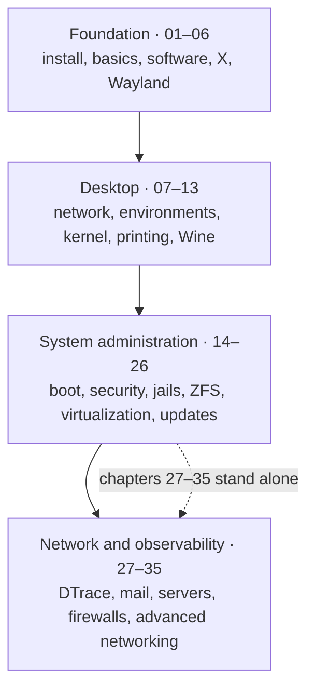

# The FreeBSD Handbook — one roadmap, 35 chapters

> **TL;DR** · *the complete path, in order, with the payoff of each chapter named up front.*
> - Four stages: **Foundation** (01–06) gets a machine running, **Desktop** (07–13) makes it yours, **System administration** (14–26) makes it trustworthy, **Network and observability** (27–35) makes it productive and debuggable.
> - Each chapter is a separate drop — take them in order the first time, then use this map to jump back to exactly the one you need.
> - Chapters refine the official FreeBSD Handbook text for 2026 readers: dated material is flagged, not silently rewritten.

## The path

**Stage 1 — Foundation (01–06).** Nothing here assumes anything.

| # | Chapter | What it buys you |
|---|---------|------------------|
| 01 | [Introduction](freebsd-01-introduction) | What FreeBSD is strong at, who runs it in production, how the project is governed. |
| 02 | [Installing FreeBSD](freebsd-02-installing-freebsd) | Image to first boot: media, bsdinstall screen by screen, ZFS or UFS, hardening toggles. |
| 03 | [FreeBSD Basics](freebsd-03-freebsd-basics) | The working vocabulary: consoles, accounts, permissions and flags, the tree, signals, shells. |
| 04 | [Packages and Ports](freebsd-04-packages-and-ports) | Software: pkg versus Ports, Quarterly versus Latest, auditing what you install. |
| 05 | [The X Window System](freebsd-05-the-x-window-system) | Pixels: Xorg, the right GPU driver, fonts, XDM. |
| 06 | [Wayland](freebsd-06-wayland-on-freebsd) | The modern display server path — and when it fits better than X. |

**Stage 2 — Desktop (07–13).** The machine becomes yours.

| # | Chapter | What it buys you |
|---|---------|------------------|
| 07 | [Network](freebsd-07-network) | Wired and wireless interfaces, gateways, and a hostname that survives reboots. |
| 08 | [Desktop Environments](freebsd-08-desktop-environments) | KDE, GNOME, Xfce — installed properly, autostarted on login. |
| 09 | [Multimedia](freebsd-09-multimedia) | Sound, video playback and webcam support without fighting the stack. |
| 10 | [Configuring the Kernel](freebsd-10-configuring-the-freebsd-kernel) | The buildkernel/installkernel loop, and when a custom kernel is worth it. |
| 11 | [Printing](freebsd-11-printing) | CUPS from zero to a working printer. |
| 12 | [Linux Binary Compatibility](freebsd-12-linux-binary-compatibility) | Run Linux software directly — no virtual machine involved. |
| 13 | [Wine](freebsd-13-wine) | Windows applications on FreeBSD through Wine. |

**Stage 3 — System administration (14–26).** The machine becomes trustworthy.

| # | Chapter | What it buys you |
|---|---------|------------------|
| 14 | [Configuration, Services and Power](freebsd-14-configuration-services-and-power) | rc.conf as the one true config, rc.d scripts, cron, powerd. |
| 15 | [The Booting Process](freebsd-15-the-freebsd-booting-process) | Every stage from firmware to init — so a broken boot is a puzzle, not a panic. |
| 16 | [Security](freebsd-16-security) | Accounts, passwords, OpenSSL, and the toolchest against compromise. |
| 17 | [Jails and Containers](freebsd-17-jails-and-containers) | Native isolation with a fraction of the weight — FreeBSD's answer to Docker. |
| 18 | [Mandatory Access Control](freebsd-18-mandatory-access-control) | MAC policies that constrain even root. |
| 19 | [Security Event Auditing](freebsd-19-security-event-auditing) | Event trails for the day you need to answer "who did what". |
| 20 | [Storage](freebsd-20-storage) | Disks, RAID, growth and backups without folklore. |
| 21 | [GEOM](freebsd-21-geom-disk-transformation-framework) | gmirror, gstripe, geli — disks as building blocks. |
| 22 | [ZFS](freebsd-22-the-z-file-system-zfs) | Datasets, snapshots, boot environments and replication — the reason many pick FreeBSD at all. |
| 23 | [Other File Systems](freebsd-23-other-file-systems) | ext4, NTFS, MSDOS and FUSE when the data lives elsewhere. |
| 24 | [Virtualization](freebsd-24-virtualization) | bhyve and friends: FreeBSD as host and guest. |
| 25 | [Localization](freebsd-25-localization-i18n-l10n) | Locales and keyboards for any language. |
| 26 | [Updating and Upgrading](freebsd-26-updating-and-upgrading-freebsd) | freebsd-update, source builds, and tracking -STABLE without fear. |

**Stage 4 — Network and observability (27–35).** The machine becomes productive.

| # | Chapter | What it buys you |
|---|---------|------------------|
| 27 | [DTrace](freebsd-27-dtrace) | Ask the running kernel questions you could not answer from logs. |
| 28 | [USB Device Mode and OTG](freebsd-28-usb-device-mode-and-otg) | FreeBSD pretending to be a USB device. |
| 29 | [Serial Communications](freebsd-29-serial-communications) | Consoles and terminals over serial — headless operation. |
| 30 | [PPP](freebsd-30-ppp) | Point-to-Point links, dialup legacy included. |
| 31 | [Electronic Mail](freebsd-31-electronic-mail) | Sendmail and the mail stack, tamed. |
| 32 | [Network Servers](freebsd-32-network-servers) | inetd, NIS and the classic services. |
| 33 | [Firewalls](freebsd-33-firewalls) | PF, IPFW and IPFILTER — one ruleset you can actually read. |
| 34 | [Advanced Networking](freebsd-34-advanced-networking) | Link aggregation, CARP and the rest of the redundancy kit. |
| 35 | [Appendices and Back Matter](freebsd-35-appendices-and-back-matter) | Reference tables worth keeping within reach. |

## How to use this roadmap

Read stage 1 in order — it is written to be. After that, the chapters are deliberately independent: jump to ZFS (22) the day you buy the new disk, to Firewalls (33) the day the box meets the internet. The chapter drops carry the detail; this map is the map.
